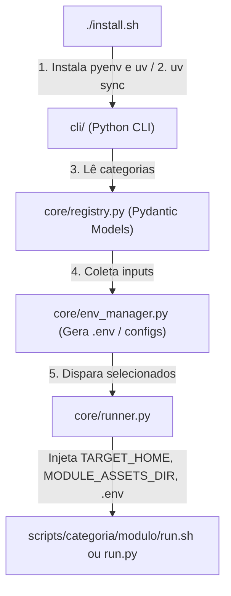

# Arquitetura do Sistema (`tema_mint_leve`)

Este documento detalha o funcionamento interno do bootstrap, do motor em Python (`core/`), da interface (`cli/`) e do contrato de execução dos scripts.

---

## 1. Fluxo de Execução Ponta a Ponta



1. **Bootstrap (`install.sh`)**:
   - Garante dependências mínimas do sistema (`curl`, `git`, dependências de build se necessário).
   - Instala/valida o `pyenv` e o `uv`.
   - Cria/sincroniza o ambiente virtual do projeto com `uv sync`.
   - Repassa a execução para o CLI em Python (`uv run python -m cli`).
2. **Descoberta (`core/registry.py`)**:
   - Varre `scripts/*/` procurando categorias válidas e seus arquivos de `registry`.
   - Valida a estrutura e os caminhos no disco usando **Pydantic**.
3. **Interação (`cli/`)**:
   - Apresenta as categorias e seus módulos no terminal.
   - Renderiza o `README.md` de cada categoria/módulo para que o usuário saiba exatamente o que será feito.
   - Coleta variáveis dinâmicas declaradas nos módulos (`env_prompts`) antes de iniciar a instalação.
4. **Execução e Resolução do Grafo de Dependências (`core/runner.py`)**:
   - Constrói um **Grafo Direcionado Acíclico (DAG)** de dependências a partir do campo `depends_on` (formato `<category_id>.<module_id>` ou `<module_id>` na mesma categoria) e do campo `order`.
   - Permite tanto rodar um script isoladamente (resolvendo e executando automaticamente seus pré-requisitos declarados no grafo) quanto rodar múltiplos módulos/categorias respeitando a ordenação topológica e detectando ciclos.
   - Gera o `.env` necessário e executa cada módulo (`.sh` via Bash ou `.py` via Python) passando o contexto por variáveis de ambiente.

---

## 2. Organização de Diretórios

```text
tema_mint_leve/
├── AGENTS.md                  # Contexto rápido e índice (Progressive Disclosure)
├── README.md                  # Comandos de uso do CLI, uv e pytest
├── install.sh                 # Bootstrap inicial (pyenv + uv + chamada do CLI)
├── pyproject.toml             # Dependências gerenciadas pelo uv
├── docs/                      # Documentação organizada por domínio (architecture, modules, testing, sdd)
├── specs/                     # Épicos e especificações do Spec-Driven Development
├── cli/                       # Camada de interface (menus, flags, renderização de READMEs)
├── core/                      # Lógica central (models Pydantic, loader de registry, DAG, runner, env)
├── scripts/                   # Módulos separados por domínio (rice, os_config, dev_env, etc.)
└── tests/                     # Suíte pytest e fixtures de sandbox
```

---

## 3. Modelagem com Pydantic (`core/models.py`)

O `core` utiliza modelos Pydantic para representar e validar categorias, módulos e o contexto de execução. As estruturas principais são:

- **`EnvPrompt`**: Define uma variável que o CLI deve perguntar ao usuário (ou assumir um valor default) para compor o `.env` (ex: `GIT_USER_EMAIL`, `PYTHON_DEFAULT_VERSION`).
- **`ScriptModule`**: Representa um módulo instalável dentro de uma categoria:
  - `id`: Identificador único dentro da categoria (ex: `xfce_light_theme`).
  - `name`: Nome amigável exibido no CLI.
  - `entrypoint`: Arquivo executável (`run.sh` ou `run.py`).
  - `runner`: Tipo de executor (`bash` ou `python`).
  - `requires_sudo`: Indica se o script precisa de privilégios administrativos.
  - `depends_on`: Lista opcional de módulos que devem rodar antes.
  - `env_prompts`: Lista opcional de variáveis solicitadas pelo módulo.
  - `expected_files`: Lista de caminhos (relativos ao `TARGET_HOME`) que o módulo deve criar/configurar — usada para validação pós-execução e testes no `pytest`.
  - *Validação de sistema de arquivos*: O validator do Pydantic garante que o `entrypoint` e o `README.md` do módulo existam na pasta do módulo.
- **`CategoryRegistry`**: Agrupa os metadados da categoria (`category_id`, `title`, `order`) e a lista de `ScriptModule`.
- **`ExecutionContext`**: Define o ambiente injetado em cada execução (`target_home`, `module_dir`, `assets_dir`, `dotenv_path`, `dry_run`).

---

## 4. Contrato de Variáveis de Ambiente do Runner

Para evitar caminhos fixos (*hardcoded*) e permitir que qualquer script funcione tanto na máquina real quanto dentro do `pytest`, o `core/runner.py` sempre injeta no processo filho:

| Variável | Descrição | Valor em Produção | Valor no Pytest (Sandbox) |
| :--- | :--- | :--- | :--- |
| `TARGET_HOME` | Diretório home alvo das configurações | `$HOME` (`/home/usuario`) | `tmp_path / "home"` |
| `MODULE_DIR` | Pasta raiz do módulo sendo executado | `.../scripts/<cat>/<mod>` | `.../scripts/<cat>/<mod>` |
| `MODULE_ASSETS_DIR` | Pasta `assets/` local daquele módulo | `.../scripts/<cat>/<mod>/assets` | `.../scripts/<cat>/<mod>/assets` |
| `DOTENV_PATH` | Caminho para o arquivo `.env` gerado | `.../.env` | `tmp_path / ".env"` |
| `DRY_RUN` | Flag indicando simulação sem efeitos colaterais | `0` (ou `1` via flag `--dry-run`) | Configurável pela fixture |
