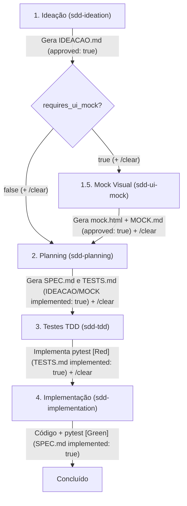

# Spec-Driven Development (SDD) — Guia de Fluxo e Padrões

O desenvolvimento do **tema_mint_leve** utiliza **Spec-Driven Development (SDD)** estruturado em **Épicos** e dividido em **4 etapas principais + 1 etapa condicional de Mock Visual (1.5)** isoladas por contexto, cada uma operada por um Agente/Skill especializado.

---

## 1. Visão Geral do Fluxo e Limpeza de Contexto

Para evitar poluição da janela de contexto com discussões exploratórias durante a codificação, **cada etapa ocorre em uma sessão limpa** (usando `/clear` ou nova conversa entre as etapas). O estado é persistido no disco dentro de `specs/` através de arquivos Markdown com **YAML Frontmatter** padronizado (`approved` e `implemented`).

Sempre que uma spec envolver **interfaces de usuário ou mudanças visuais** (`requires_ui_mock: true`, ex: alterar cores do tema GTK3, estilizar o `xfce4-panel`, alterar bordas de janelas no `xfwm4`, cores de terminal ou *rice*), a **Etapa 1.5 — Mock Visual (`sdd-ui-mock`)** torna-se obrigatória entre a Ideação e o Planning.
Essa etapa é integrada ao **Atomic Design System central do projeto (`design_system/`)**: antes de desenhar o mock, o agente consulta `design_system/css/design-system.css` e os showcases navegáveis (`tokens.html`, `atoms.html`, `molecules.html`, `organisms.html`) para reutilizar cores, fontes, átomos e moléculas existentes; e, assim que o mock é aprovado e portado, os novos componentes e o organismo resultante sobem para o `design_system/`.



---

## 2. Estrutura de Diretórios (`specs/`)

As especificações são agrupadas por **Épicos** (diretórios temáticos) e, dentro deles, por pastas numeradas de cada **Spec**:

```text
specs/
└── <epico>/                                 # Ex: 01_core_engine, 02_dev_python, 03_rice_xfce
    └── <NN_nome_da_spec>/                   # Ex: 01_tema_gtk_e_bordas
        ├── SPEC.md                          # Especificação técnica, contrato Pydantic/Registry e portabilidade UI
        ├── TESTS.md                         # Plano enxuto de testes TDD (3 a 5 testes focados)
        └── referencias/                     # Arquivos de apoio, rascunhos, mocks visuais e configs de referência
            ├── IDEACAO.md                   # Registro histórico da etapa 1 (mantido como referência)
            ├── MOCK.md                      # (Quando requires_ui_mock: true) Contrato de tokens, guardrails e portabilidade
            ├── mock.html                    # (Quando requires_ui_mock: true) Preview visual HTML/CSS autocontido
            └── ...                          # Outras referências permanentes (se houver)
```

> **Regra de Limpeza da Pasta da Spec**: Na raiz de `specs/<epico>/<spec>/` devem existir **apenas** `SPEC.md`, `TESTS.md` e o diretório `referencias/`. Qualquer artefato auxiliar (incluindo `IDEACAO.md`, `MOCK.md` e `mock.html`) fica dentro de `referencias/`.

---

## 3. Controle de Estado: Frontmatter + Double-Check

Nenhum agente deve confiar apenas na **existência** de um arquivo para avançar de etapa (pois uma conversa pode ter sido interrompida no meio ou ainda não aprovada pelo usuário).

### 3.1. As Flags de Controle
Todos os documentos do ciclo (`IDEACAO.md`, `MOCK.md`, `SPEC.md` e `TESTS.md`) possuem obrigatoriamente as flags booleanas `approved` e `implemented` no seu YAML Frontmatter (e `IDEACAO.md`/`SPEC.md` possuem também `requires_ui_mock: true | false`):

- **`requires_ui_mock: true | false`**: Definida na Ideação. Se `true`, bloqueia a geração do `SPEC.md` até que `referencias/MOCK.md` esteja com `approved: true` e `referencias/mock.html` exista no disco.
- **`approved: true | false`**: Indica se o usuário revisou e aprovou aquele documento/mock/plano.
- **`implemented: true | false`**: Indica se o artefato prático resultante daquele documento já foi concretizado:
  - No **`IDEACAO.md`**: Nasce `implemented: false`. Quando o agente de Planning transforma a ideação em `SPEC.md` e `TESTS.md`, ele marca `implemented: true` no frontmatter de `referencias/IDEACAO.md`.
  - No **`MOCK.md`** (quando `requires_ui_mock: true`): Nasce `implemented: false` junto com `referencias/mock.html`. Quando o usuário aprova o visual (`approved: true`) e o agente de Planning traduz o mock e sua tabela de portabilidade CSS -> GTK3/XFCE para dentro do `SPEC.md`, o agente marca `implemented: true` em `referencias/MOCK.md`.
  - No **`TESTS.md`**: `approved: true` significa que o usuário aprovou os cenários de teste descritos. `implemented: true` significa que o Agente de TDD já escreveu o código real dos testes em `tests/` e confirmou a fase *Red* no `pytest`.
  - No **`SPEC.md`**: `approved: true` significa que o usuário aprovou a especificação técnica. `implemented: true` significa que o Agente de Implementação já escreveu o código/script real e todos os testes do `pytest` passaram (fase *Green*).

### 3.2. Regra do Double-Check (Frontmatter + Realidade)
Antes de iniciar qualquer etapa, o agente deve realizar um **double-check**:
1. **Check 1 (Frontmatter)**: Verificar se `approved: true` (e `implemented: true` da etapa anterior) está marcado no YAML frontmatter (incluindo o check de `referencias/MOCK.md` quando `requires_ui_mock: true`).
2. **Check 2 (Realidade no Repositório)**: Confirmar no sistema de arquivos e via `uv run pytest` se o estado real corresponde ao frontmatter (ex: `referencias/mock.html` existe quando `requires_ui_mock: true`? O arquivo de teste realmente existe em `tests/`? A suíte de testes existente está íntegra?).

---

## 4. Modelos de Documentos (`docs/sdd/templates/`)

Os modelos de cada documento ficam em arquivos separados dentro de `docs/sdd/templates/` para que cada agente carregue apenas o modelo que precisa utilizar:

- **[templates/IDEACAO.template.md](templates/IDEACAO.template.md)**: Modelo de `referencias/IDEACAO.md` (YAML frontmatter obrigatório com `requires_ui_mock` + corpo livre com as decisões rápidas da etapa 1).
- **[templates/MOCK.template.md](templates/MOCK.template.md)**: Modelo de `referencias/MOCK.md` (Tokens visuais 1:1, checklist de guardrails CSS Web vs. GTK3/XFCE e tabela de portabilidade de seletores do `mock.html` para `gtk.css` e `xfwm4`).
- **[templates/SPEC.template.md](templates/SPEC.template.md)**: Modelo travado de `SPEC.md` (Objetivo, Grafo de Dependências, Registry YAML, Modelo Pydantic, Contrato de Execução + Portabilidade UI do Mock, Snippets Principais e Critérios de Aceite).
- **[templates/TESTS.template.md](templates/TESTS.template.md)**: Modelo travado de `TESTS.md` (Sem código Python; 3 a 5 testes com os 4 campos obrigatórios: *Marker/O que testa*, *Entrada*, *Fixtures & Mocks* e *Resultado Esperado*).

---

## 5. Skills e Agentes Disponíveis (`.agents/skills/`)

| Skill / Agente | Arquivo | Modelo Referenciado | Responsabilidade Principal |
| :--- | :--- | :--- | :--- |
| **Skill Master (`sdd-workflow`)** | `.agents/skills/sdd-workflow/SKILL.md` | — | Inspeciona `specs/<epico>/<spec>/`, faz o double-check dos frontmatters (`approved`/`implemented`/`requires_ui_mock`) + realidade (incluindo leitura de placeholders `IDEACAO.md` pré-existentes) e aciona a etapa correta. |
| **1. Ideação (`sdd-ideation`)** | `.agents/skills/sdd-ideation/SKILL.md` | [IDEACAO.template.md](templates/IDEACAO.template.md) | Verifica e continua a partir de `referencias/IDEACAO.md` pré-existente (se houver), conduz entrevista de baixo atrito (Sim/Não, 1/2/3), subdivide proativamente escopos grandes em múltiplas specs com placeholders `IDEACAO.md` (`approved: false`) e gera o `referencias/IDEACAO.md` aprovado. |
| **1.5. Mock Visual (`sdd-ui-mock`)** | `.agents/skills/sdd-ui-mock/SKILL.md` | [MOCK.template.md](templates/MOCK.template.md) | *(Condicional: `requires_ui_mock: true`)* Gera preview `referencias/mock.html` aplicando guardrails estritos de CSS compatível com GTK3/XFCE e documenta o mapa de portabilidade em `referencias/MOCK.md`. |
| **2. Planning (`sdd-planning`)** | `.agents/skills/sdd-planning/SKILL.md` | [SPEC.template.md](templates/SPEC.template.md) & [TESTS.template.md](templates/TESTS.template.md) | Lê `IDEACAO.md` (e `MOCK.md` + `mock.html` quando `requires_ui_mock: true`), gera `SPEC.md` (com guia de portabilidade CSS -> OS) e `TESTS.md`, e marca `IDEACAO.md`/`MOCK.md` como `implemented: true`. |
| **3. Testes TDD (`sdd-tdd`)** | `.agents/skills/sdd-tdd/SKILL.md` | [TESTS.template.md](templates/TESTS.template.md) | Roda `pytest` inicial, refina/aprova `TESTS.md` (máx 3–5 testes), implementa os testes em `tests/` (fase *Red*) e marca `TESTS.md` como `implemented: true`. |
| **4. Implementação (`sdd-implementation`)** | `.agents/skills/sdd-implementation/SKILL.md` | — | Verifica `SPEC.md` (`approved: true`) e `TESTS.md` (`implemented: true`), roda `pytest` prévio, implementa o código/script, passa nos testes (*Green*) e marca `SPEC.md` como `implemented: true`. |
